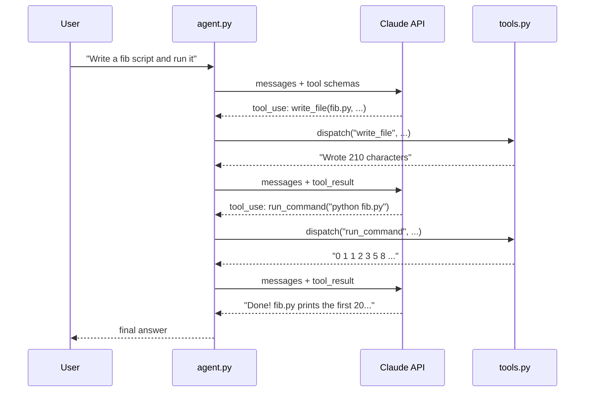

# Forge — a mini AI agent built from scratch

A fully working coding agent in ~200 lines of Python. No LangChain, no
framework — just the Anthropic API and a `while` loop.

Built as a learning project to show what an "AI agent" actually is under the
hood: **an LLM inside a loop with tools**.

## Table of contents

- [How it works](#how-it-works)
- [Tools](#tools)
- [Project structure](#project-structure)
- [Setup](#setup)
- [Run it](#run-it)
- [Deploy the web UI](#deploy-the-web-ui-streamlit-cloud)
- [How memory works](#how-memory-works)
- [Extending the agent](#extending-the-agent)
- [Safety notes](#safety-notes)

## How it works

An LLM can't *do* anything — it only produces text. The trick: you describe
your tools to it as JSON schemas, and instead of answering, the model can reply
with a structured request like:

```json
{"name": "read_file", "input": {"path": "README.md"}}
```

Your code executes that request and sends the output back as a `tool_result`
message. The loop repeats until the model answers in plain text:

```python
while not done:
    response = claude(messages, tools)
    if response asks to use a tool:
        result = run_the_tool(response.tool_call)
        messages.append(result)   # feed the result back
    else:
        done = True               # final text answer
```



Key files, in reading order:

- **`prompts.py`** — the system prompt: the agent's "job description," sent
  with every API call.
- **`tools.py`** — the tool implementations + the JSON schemas handed to the
  API, plus `dispatch()` which maps tool name → function.
- **`agent.py`** — the loop above, written for real. `stop_reason ==
  "end_turn"` is how Claude says "I'm done."

## Tools

| Tool          | What it does                                  |
| ------------- | --------------------------------------------- |
| `read_file`   | Read a file in the sandboxed workspace        |
| `write_file`  | Create/overwrite a file                       |
| `list_files`  | List workspace directory contents             |
| `run_command` | Run a shell command (30s timeout, in sandbox) |

All file and shell access is confined to `./sandbox/` — the agent can't touch
the rest of your filesystem.

## Project structure

```
ai-agent/
  agent.py          # the agent loop (the important file)
  tools.py          # tool implementations + JSON schemas
  prompts.py        # system prompt
  cli.py            # terminal UI
  app.py            # Streamlit web UI
  requirements.txt
  .env.example      # copy to .env and add your key
  sandbox/          # the agent's playground (created on first run)
```

## Setup

Prerequisites: Python 3.10+ and an
[Anthropic API key](https://console.anthropic.com/).

```bash
git clone https://github.com/AbdulhameedSk/AI-Coding-Agent
cd AI-Coding-Agent
pip install -r requirements.txt
```

Then create a `.env` file (it's git-ignored, so your key stays local):

```
ANTHROPIC_API_KEY=sk-ant-your-key-here
```

## Run it

**Terminal:**

```bash
python cli.py
```

**Web UI:**

```bash
streamlit run app.py
```

Opens http://localhost:8501. Try:

- "Create a Python script that prints the first 20 Fibonacci numbers, then run it."
- "Write a small HTML page about Mars and a README describing this workspace."
- "List the files here and summarize what each one does."

You'll see each tool call and its result printed as it happens — watch the
loop work.

## Deploy the web UI (Streamlit Cloud)

Free hosting at [share.streamlit.io](https://share.streamlit.io):

1. Push this repo to GitHub (public).
2. Sign in to Streamlit Community Cloud with your GitHub account.
3. **New app** → pick this repo → main file: `app.py` → **Deploy**.
4. In the app's **Settings → Secrets**, add:

   ```toml
   ANTHROPIC_API_KEY = "sk-ant-your-key-here"
   ```

5. You get a public URL like `https://your-app.streamlit.app`.

> Never put your API key in the repo — Streamlit Secrets keep it server-side.

## How memory works

`self.messages` is a plain Python list. Every API call resends the entire
conversation — including tool calls and their results. That's all "memory"
is: no database, no vector store. If the conversation outgrows the context
window, that's when you'd add summarization or retrieval — but you don't need
them to build a real agent.

## Extending the agent

The design makes growth easy:

- **New tool**: write a function in `tools.py`, add a schema to
  `TOOL_SCHEMAS`, add it to `dispatch()`. Done — the model figures out when
  to use it from the description.
- **Different behavior**: edit `SYSTEM_PROMPT` in `prompts.py`. No retraining,
  just different instructions.
- **Different model**: change `MODEL` in `agent.py`.

## Safety notes

- `run_command` executes real shell commands — it's sandboxed to
  `./sandbox/` with a 30s timeout, but treat it as powerful. For untrusted
  use, add a human-confirmation step before executing.
- `MAX_STEPS = 25` caps the loop so a confused agent can't spin forever
  burning tokens.
- `.env` is git-ignored. Never commit API keys.
